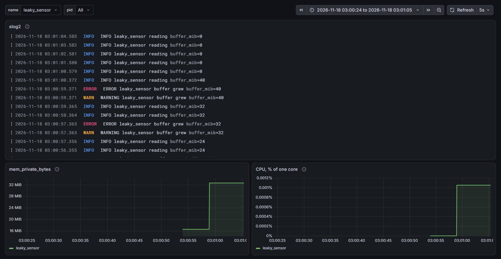

# Fluent Bit for QNX 8.0

[Fluent Bit](https://fluentbit.io/) 5.2.0, the CNCF graduated log and telemetry agent, ported to QNX 8.0, with two new inputs written for QNX. `slog2` reads the QNX system log live. `qnx_proc` reports CPU time and private memory for every process. One script cross-builds it with the QNX SDP 8.0 toolchain, and one script runs a demo in which a QNX 8.0 machine ships its logs and process data to a dashboard on the host.

It runs today on QNX 8.0 x86_64 under QEMU. The latest full check built it from clean, ran 20 tests on the QNX target plus the demo check, and all of them passed ([docs/test-log.txt](docs/test-log.txt)). What is not done is listed once, under [Limits](#limits). Built for the QNX Global Hackathon 2026.



## Why it matters

QNX runs in vehicles, medical devices and industrial controllers. A company with a fleet of them needs their logs and health in one place, and on Linux that job usually goes to Fluent Bit, a [CNCF graduated project](https://github.com/fluent/fluent-bit): one small agent that reads local logs and process data and ships them off the device. This build carries the http, forward and Loki outputs.

A real-time system adds a rule a Linux agent never had to follow: shipping logs must not hold off the work the device is there to do. On QNX that rule can be written down and checked. The agent starts with `on -p 8`, below the priority 10 that ordinary work runs at, QNX schedules the higher number first, and a test reads the priority of every agent thread on the target ([Running on a real-time system](#running-on-a-real-time-system)).

Earlier work we found:

- The upstream request [fluent/fluent-bit#8757](https://github.com/fluent/fluent-bit/issues/8757) ("Porting fluent-bit on QNX OS") was closed as stale on 2024-08-01. A search of pull requests in that repository for QNX returned nothing on 2026-11-13.
- [dantunan/fluent-bit-for-qnx](https://github.com/dantunan/fluent-bit-for-qnx) is a 2024 fork aimed at QNX 7.1. Its README calls it "still in process" and lists a receiver crash as a known issue. It was last pushed in May 2024.
- The [QNX ports dashboard](https://oss.qnx.com/) returned no package for `fluent-bit` on 2026-11-13 (package search count 0). [github.com/qnx-ports/fluent-bit](https://github.com/qnx-ports/fluent-bit) is not a repository, [qnx-ports/build-files](https://github.com/qnx-ports/build-files) has no `ports/fluent-bit` directory, and a code search for `fluent-bit` across the `qnx-ports` organization returned no hits the same day.
- QNX's port of the automotive DLT daemon ([qnx-ports/dlt-daemon](https://github.com/qnx-ports/dlt-daemon)) has a slog2 adapter that feeds DLT. This project feeds the same system log to Fluent Bit's outputs instead.

## What works

[`tools/test-all.sh`](tools/test-all.sh) exercises these rows on the QNX 8.0 x86_64 QEMU target and records each result in [docs/test-log.txt](docs/test-log.txt). [`tools/smoke.sh`](tools/smoke.sh) is the extra stdout check.

| Piece | What it does | Tested on QNX by |
| --- | --- | --- |
| dummy | Synthetic input records | [`http_delivers_dummy_records`](tests/test_outputs.sh) |
| tail | Lines appended to a file, in order, once each | [`tail_delivers_appended_lines_in_order`](tests/test_outputs.sh), [`0010`](patches/0010-in_tail-resolve-the-file-name-with-iofdinfo-on-QNX.patch), [`0011`](patches/0011-in_tail-drop-output-only-bits-from-the-inotify-mask-.patch) |
| slog2 | QNX system-log input | [`slog2_lines_arrive_with_severity`](tests/test_slog2.sh), [`slog2_from_now_skips_history`](tests/test_slog2.sh), [`slog2_match_filters_buffer_sets`](tests/test_slog2.sh), [`slog2_shutdown_is_clean`](tests/test_slog2.sh) |
| qnx_proc | One record per process: name, threads, CPU time, private memory | [`proc_reports_named_process`](tests/test_qnx_proc.sh), [`proc_cpu_increases_for_spinner`](tests/test_qnx_proc.sh), [`proc_match_filters_names`](tests/test_qnx_proc.sh), [`proc_survives_short_lived_processes`](tests/test_qnx_proc.sh) |
| stdout | Prints a record on the target | [`tools/smoke.sh`](tools/smoke.sh) (not part of `tools/test-all.sh`) |
| http | Delivers records to a host listener | [`http_delivers_dummy_records`](tests/test_outputs.sh), [`tail_delivers_appended_lines_in_order`](tests/test_outputs.sh) |
| forward | Delivers every tail line once | [`forward_delivers_every_tail_line`](tests/test_outputs.sh) |
| loki | Pushes records to Loki | [`loki_push_received`](tests/test_outputs.sh), [`tools/demo-check.sh`](tools/demo-check.sh) |
| two output workers | Shutdown finishes with no pending tasks | [`two_workers_shutdown_clean`](tests/test_outputs.sh) |
| poll event loop | The QNX build selects `poll` | [`qnx/cmake-options.txt`](qnx/cmake-options.txt) (`FLB_EVENT_LOOP_POLL`). The tests above run that binary |
| filesystem storage, process still up | Records wait on disk while the receiver is down, then arrive | [`agent_buffers_while_receiver_down_then_delivers`](tests/test_service.sh) |
| priority-8 service | The agent runs at the configured priority and stops cleanly | [`agent_runs_at_configured_priority`](tests/test_service.sh), [`agent_stops_cleanly`](tests/test_service.sh) |

`cpu_ns` and `mem_private_bytes` in the records are figures about the processes the agent watches, such as the demo program `leaky_sensor`.

## Dashboard

The picture at the top is the demo dashboard [QNX fleet](demo/host/grafana/dashboards/qnx-fleet.json) during a demo run: `leaky_sensor` logs steady readings, then a WARNING and an ERROR each time its buffer grows, its private memory climbs, and the demo restarts it. The panels are the slog2 lines of the buffer sets the name filter selects, `mem_private_bytes`, and CPU as a percent of one core (the per-second increase of `cpu_ns`). The name filter in that picture is `leaky_sensor`. The pid filter is All. [`tools/demo-check.sh`](tools/demo-check.sh) checks that Loki stored a `leaky_sensor` INFO line, an ERROR line, and a rise in `mem_private_bytes`. [demo/README.md](demo/README.md) describes the run.

## Quick start

You need:

- **QNX version:** QNX SDP 8.0 in `~/qnx800` (or set `QNX_SDP` to where it is), installed with QNX Software Center. The free QNX Everywhere non-commercial license is enough.
- **Toolchain:** the SDP's `qcc` and `q++` for `gcc_ntox86_64` (GCC 12.2.0), driven by CMake and Ninja through [`qnx/qnx-x86_64.cmake`](qnx/qnx-x86_64.cmake).
- **Target:** QNX 8.0 x86_64 under QEMU. [`tools/qemu-up.sh`](tools/qemu-up.sh) builds the image once with the SDP's `mkqnximage`, boots it headless with 1.5 GB of memory and 2 CPUs (KVM when `/dev/kvm` is writable), and forwards SSH to `127.0.0.1:2222`. A target that is already running from that image directory is reused, so no second guest is started.
- **Host:** Linux x86_64 or WSL2 with `cmake`, `ninja`, `qemu-system-x86_64`, `python3`, `curl`, `patch`, `tar`, `sha256sum`, `ssh` and `scp`. On Ubuntu: `sudo apt install cmake ninja-build qemu-system-x86 qemu-utils python3 curl patch openssh-client`.
- **Network:** the first build downloads the pinned Fluent Bit tarball, and the first demo downloads the pinned Loki and Grafana archives ([`demo/host/versions.txt`](demo/host/versions.txt)). Each is checked against its SHA-256. The demo uses ports 3100 (Loki) and 3000 (Grafana). The tests use 9880, 24224 and 13100.

From the repository root:

```bash
source tools/env.sh     # QNX SDP 8.0 environment and the paths the tools use
tools/build.sh          # download Fluent Bit 5.2.0, apply patches/, cross-build with qcc
tools/qemu-up.sh        # build the QNX 8.0 QEMU image once, boot it, wait for SSH
tools/deploy.sh         # copy the agent to the target
tools/demo.sh           # agent, leaky_sensor and the live dashboard, narrated
```

`tools/demo.sh` prints `http://127.0.0.1:3000/d/qnx-fleet/qnx-fleet`. That address is live only while `tools/demo.sh` is still running, because the script stops the charts on the way out. `tools/demo.sh --hold 300` keeps everything running for 300 seconds after the memory drop, so the dashboard can be watched or filmed. The same path with no browser is:

```bash
tools/demo-check.sh
```

The full check (patches, a clean build, every on-machine test, and the demo check) is:

```bash
tools/test-all.sh
```

[`tools/build.sh`](tools/build.sh) builds with `ninja -j4`. Upstream source is not in this repository. [`UPSTREAM`](UPSTREAM) pins the tarball, and that script downloads it into the cache when the file is missing or the SHA-256 differs. [`tools/qemu-down.sh`](tools/qemu-down.sh) stops the target.

## QNX inputs

Both inputs are original sources in [`plugins/`](plugins/). [`0012`](patches/0012-plugins-register-qnx-inputs.patch) registers them. `tools/build.sh` copies `plugins/` into the extracted tree before configure. The agent config is [`qnx/fluent-bit.conf`](qnx/fluent-bit.conf). It sets `mem_buf_limit 5M` and `storage.type filesystem` on each input and leaves the plugin keys at their defaults.

### slog2

Config keys in [`plugins/in_slog2/in_slog2.c`](plugins/in_slog2/in_slog2.c):

| Key | Default | Meaning |
| --- | --- | --- |
| `match` | empty | Comma-separated slog2 buffer-set names. Empty reads all of them |
| `from_now` | `true` | Read packets logged after this input starts |
| `poll_interval_ms` | `100` | Milliseconds between live-parse polls. Must be positive |

Record fields: `buffer_set`, `buffer`, `severity`, `severity_num`, `pid`, `thread_id`, `code`, `message`.

Severity names in the plugin are `SHUTDOWN`, `CRITICAL`, `ERROR`, `WARNING`, `NOTICE`, `INFO`, `DEBUG1`, `DEBUG2`, and `UNKNOWN`. [`slog2_lines_arrive_with_severity`](tests/test_slog2.sh) checks `INFO`, `WARNING`, and `ERROR`.

The input calls `slog2_parse_settings` and `slog2_parse_all` from `<slog2_parse.h>` on its own thread, and queues packets back to the engine. [`slog2_shutdown_is_clean`](tests/test_slog2.sh) checks that the process exits cleanly with idle and busy inputs. It does not prove that a blocked parser thread is reclaimed during an in-process reload. The queue can drop old packets when full. See [buffering and shutdown limits](docs/porting-notes.md#slog2-buffering-and-shutdown-limits).

Stopping the input releases its packet queue even if the parser remains blocked.
The [stop lifecycle check](tests/test_slog2_stop.sh) forces shutdown races with real
QNX threads and verifies queue, pipe and completed-thread cleanup. Its scope and
results are recorded in [stop cleanup validation](docs/slog2-stop-validation.md).

### qnx_proc

Config keys in [`plugins/in_qnx_proc/in_qnx_proc.c`](plugins/in_qnx_proc/in_qnx_proc.c):

| Key | Default | Meaning |
| --- | --- | --- |
| `interval_sec` | `5` | Seconds between process scans |
| `interval_nsec` | `0` | Extra nanoseconds between scans |
| `match` | empty | Regular expression applied to the process name, in the same Ruby syntax as Fluent Bit's grep filter (for example `^(memhog|spinner)$`). It is case sensitive and matches anywhere in the name unless anchored. Empty reports every process it can read. The plugin skips its own process unless `include_self` is on |
| `include_self` | `false` | Also report this Fluent Bit process |

Record fields: `pid`, `name`, `threads`, `cpu_ns`, `cpu_user_ns`, `cpu_system_ns`, `mem_private_bytes`.

`cpu_ns` is the process user time plus system time. `mem_private_bytes` is that process's private memory. [`proc_reports_named_process`](tests/test_qnx_proc.sh) checks a named process and its private memory. [`proc_cpu_increases_for_spinner`](tests/test_qnx_proc.sh) checks that the spinner's `cpu_ns` increases.

For each numeric directory under `/proc`, the plugin opens `/proc/<pid>/ctl` (and `/proc/<pid>/as` if `ctl` is missing), then `devctl` with `DCMD_PROC_INFO` and `DCMD_PROC_MAPDEBUG_BASE`. The name can also come from `/proc/<pid>/exefile`. [`proc_survives_short_lived_processes`](tests/test_qnx_proc.sh) checks that processes exiting during the scan do not stop the input.

Both inputs keep the rest of a batch when one record cannot be encoded, and report a batch Fluent Bit refuses without flooding the log. [`test_collect_faults.sh`](tests/test_collect_faults.sh) forces each case on the target. See [record and hand-off errors](docs/porting-notes.md#record-and-hand-off-errors).

## Running on a real-time system

[`qnx/fluent-bit.conf`](qnx/fluent-bit.conf) is the agent. [`tools/start-agent.sh`](tools/start-agent.sh) copies it to the target and replaces `__TARGET_DIR__` with the real directory, so the agent does not depend on its environment. [`tools/stop-agent.sh`](tools/stop-agent.sh) sends SIGTERM and waits until the process has exited 0.

The service sets `storage.path` to `$FBQ_TARGET_DIR/storage` (the file contains `__TARGET_DIR__/storage`) and `storage.max_chunks_up 128`. Each input uses `mem_buf_limit 5M` and `storage.type filesystem`. The Loki output uses host `10.0.2.2`, port `3100`, `labels job=fluent-bit-qnx`, and `retry_limit false`. `FBQ_LOKI_HOST` and `FBQ_LOKI_PORT` override the host and port on the copy start-agent writes.

`retry_limit false` keeps a chunk that could not be sent. [`agent_buffers_while_receiver_down_then_delivers`](tests/test_service.sh) covers that path while the process stays up.

[`tools/start-agent.sh`](tools/start-agent.sh) launches Fluent Bit with `on -p 8` unless `FBQ_PRIORITY` is set. The priority is 8 so ordinary priority-10 work stays ahead of log shipping ([docs/porting-notes.md](docs/porting-notes.md)). [`agent_runs_at_configured_priority`](tests/test_service.sh) reads every thread of the fluent-bit pid. [`agent_stops_cleanly`](tests/test_service.sh) checks the exit status. Test helpers that start Fluent Bit themselves still use priority 10.

## Evidence of QNX use

Every patch:

- [`0001`](patches/0001-build-add-QNX-detection-and-link-libsocket-and-libfs.patch) links `libsocket` and `libfsnotify` and defines `FLB_SYSTEM_QNX`.
- [`0002`](patches/0002-core-do-not-define-a-valueless-_XOPEN_SOURCE-on-QNX.patch) does not define a valueless `_XOPEN_SOURCE` on QNX.
- [`0003`](patches/0003-tls-include-inet-headers-before-OpenSSL-on-QNX.patch) includes the inet headers before OpenSSL.
- [`0004`](patches/0004-chunkio-take-byte-order-helpers-from-gulliver.h-on-Q.patch) takes chunkio byte-order helpers from `<gulliver.h>`.
- [`0005`](patches/0005-snappy-take-byte-order-helpers-from-gulliver.h-on-QN.patch) does the same for snappy.
- [`0006`](patches/0006-chunkio-use-stat-2-instead-of-d_type-to-scan-on-QNX.patch) scans directories with `stat(2)` because `struct dirent` has no `d_type`.
- [`0007`](patches/0007-chunkio-use-ftw-3-for-recursive-delete-on-QNX.patch) uses `nftw()` where `<fts.h>` is missing.
- [`0008`](patches/0008-monkey-skip-sys-syscall.h-and-gettid-on-QNX.patch) skips `<sys/syscall.h>` and labels the worker with `pthread_self()`.
- [`0009`](patches/0009-network-skip-SO_PEERCRED-unix-socket-peer-pid-on-QNX.patch) compiles out `SO_PEERCRED`.
- [`0010`](patches/0010-in_tail-resolve-the-file-name-with-iofdinfo-on-QNX.patch) resolves an open file with `iofdinfo`.
- [`0011`](patches/0011-in_tail-drop-output-only-bits-from-the-inotify-mask-.patch) requests only `IN_ATTRIB | IN_MODIFY` from the QNX inotify watch.
- [`0012`](patches/0012-plugins-register-qnx-inputs.patch) registers the two QNX inputs.

QNX calls in the plugins:

- [`plugins/in_slog2/in_slog2.c`](plugins/in_slog2/in_slog2.c) calls `slog2_parse_settings` and `slog2_parse_all`.
- [`plugins/in_qnx_proc/in_qnx_proc.c`](plugins/in_qnx_proc/in_qnx_proc.c) calls `devctl` with `DCMD_PROC_INFO` and `DCMD_PROC_MAPDEBUG_BASE`, and reads `/proc/<pid>/ctl`, `/proc/<pid>/as`, and `/proc/<pid>/exefile`.

The full-check record is [docs/test-log.txt](docs/test-log.txt). The patch-by-patch notes are [docs/porting-notes.md](docs/porting-notes.md).

## Upstream

[`UPSTREAM`](UPSTREAM) pins Fluent Bit 5.2.0, the release tarball, its SHA-256, and commit `e0149076aeff009d35fd495e55379cb78f1eb53f`. `tools/check-patches.sh` applies `patches/*.patch` in order to a pristine extract and refuses a NUL byte, CRLF, a missing `Signed-off-by`, or a patch that does not apply.

The core of this port is offered upstream as [fluent/fluent-bit#12811](https://github.com/fluent/fluent-bit/pull/12811), opened 2026-11-18 against Fluent Bit master (5.2.1). It carries patches 0001 to 0003 and 0009 to 0011 as seven commits, one per component, each with a Developer Certificate of Origin sign-off. Patch 0001 is reworked there to link `libsocket` and `libfsnotify` through `FLB_DEPS` instead of a global `link_libraries()`. Before it was opened, that branch plus patches 0004 to 0008 was cross-built for QNX 8.0 and passed the output tests and the smoke test on the target, and on Linux its changed files preprocess to the same tokens apart from `__LINE__` values and Fluent Bit's own `in_tail` integration scenario passes. The PR description has the details. The bundled-library patches (0004 to 0008, chunkio, snappy and monkey) are not in that PR, because Fluent Bit maintains `lib/` separately.

## How it was built

Jake Hoffman built this by directing AI coding agents. The port was implemented in Cursor sessions, and OpenAI Codex and Claude (Anthropic) made the later fixes. Each of those fixes was checked on the QNX target before it was pushed. The git author on every commit is Jake Hoffman `<122403457+jakethehoffer@users.noreply.github.com>`. [docs/how-it-was-built.md](docs/how-it-was-built.md) has the longer account from `git log` and the feasibility spike, including a correction about the `Co-Authored-By` trailers on the early commits.

## Limits

- x86_64 only. aarch64 is not built.
- Not exercised yet: saved chunks coming back after the agent restarts, TLS to a real endpoint, tail `db=`, and file rotation.
- Unix-socket peer pid is unavailable on QNX ([`0009`](patches/0009-network-skip-SO_PEERCRED-unix-socket-peer-pid-on-QNX.patch)).
- slog2: the parser's queue drops its oldest packets when it is full, and a parser thread still blocked inside `slog2_parse_all` is not reclaimed during an in-process reload ([buffering and shutdown limits](docs/porting-notes.md#slog2-buffering-and-shutdown-limits)).
- Dashboard: the name control is a fixed choice in the dashboard file, not a live list, and NOTICE lines share the INFO color (the line itself still says NOTICE).

Details are in [docs/porting-notes.md](docs/porting-notes.md).

## License

Apache-2.0. See [LICENSE](LICENSE) and [NOTICE](NOTICE). Fluent Bit is a CNCF project under the Apache License 2.0: [github.com/fluent/fluent-bit](https://github.com/fluent/fluent-bit). This repository does not contain the Fluent Bit source tree (the patches quote the lines they change) or any QNX software.
