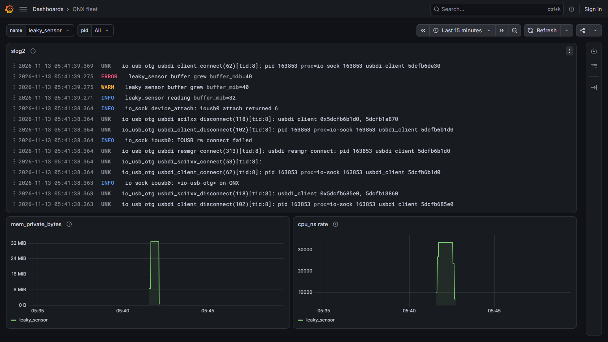

# Fluent Bit for QNX 8.0, with QNX-native slog2 and process inputs

## Why it matters

Fleets of QNX devices have no standard modern log and telemetry shipper. Fluent Bit is the CNCF standard for that job: [fluentbit.io](https://fluentbit.io/) describes it as a CNCF graduated project, and so does the [Fluent Bit repository](https://github.com/fluent/fluent-bit).

The upstream request [fluent/fluent-bit#8757](https://github.com/fluent/fluent-bit/issues/8757) ("Porting fluent-bit on QNX OS") was closed as stale on 2024-08-01. A search of pull requests in that repository for QNX returned nothing on 2026-11-13.

The [QNX ports dashboard](https://oss.qnx.com/) returned no package for `fluent-bit` on 2026-11-13 (package search count 0). [github.com/qnx-ports/fluent-bit](https://github.com/qnx-ports/fluent-bit) is not a repository, and [qnx-ports/build-files](https://github.com/qnx-ports/build-files) has no `ports/fluent-bit` directory. A code search for `fluent-bit` across the `qnx-ports` organization returned no hits the same day.

## What works

[`tools/test-all.sh`](tools/test-all.sh) exercises these rows on the QNX 8.0 x86_64 QEMU target and records each result in [docs/test-log.txt](docs/test-log.txt). [`tools/smoke.sh`](tools/smoke.sh) is the extra stdout check.

| Piece | What it does | Tested on QNX by |
| --- | --- | --- |
| dummy | Synthetic input records | [`http_delivers_dummy_records`](tests/test_outputs.sh) |
| tail | Lines appended to a file, in order, once each | [`tail_delivers_appended_lines_in_order`](tests/test_outputs.sh), [`0010`](patches/0010-in_tail-resolve-the-file-name-with-iofdinfo-on-QNX.patch), [`0011`](patches/0011-in_tail-drop-output-only-bits-from-the-inotify-mask-.patch) |
| slog2 | QNX system-log input | [`slog2_lines_arrive_with_severity`](tests/test_slog2.sh), [`slog2_from_now_skips_history`](tests/test_slog2.sh), [`slog2_match_filters_buffer_sets`](tests/test_slog2.sh), [`slog2_shutdown_is_clean`](tests/test_slog2.sh) |
| qnx_proc | One record per process: name, threads, CPU time, private memory | [`proc_reports_named_process`](tests/test_qnx_proc.sh), [`proc_cpu_increases_for_spinner`](tests/test_qnx_proc.sh), [`proc_match_filters_names`](tests/test_qnx_proc.sh), [`proc_survives_short_lived_processes`](tests/test_qnx_proc.sh) |
| stdout | Prints a record on the target | [`tools/smoke.sh`](tools/smoke.sh) (not part of `tools/test-all.sh`) |
| http | Delivers records to a host listener | [`http_delivers_dummy_records`](tests/test_outputs.sh), [`tail_delivers_appended_lines_in_order`](tests/test_outputs.sh) |
| forward | Delivers every tail line once | [`forward_delivers_every_tail_line`](tests/test_outputs.sh) |
| loki | Pushes records to Loki | [`loki_push_received`](tests/test_outputs.sh), [`tools/demo-check.sh`](tools/demo-check.sh) |
| two output workers | Shutdown finishes with no pending tasks | [`two_workers_shutdown_clean`](tests/test_outputs.sh) |
| poll event loop | The QNX build selects `poll` | [`qnx/cmake-options.txt`](qnx/cmake-options.txt) (`FLB_EVENT_LOOP_POLL`). The tests above run that binary |
| filesystem storage, process still up | Records wait on disk while the receiver is down, then arrive | [`agent_buffers_while_receiver_down_then_delivers`](tests/test_service.sh) |
| priority-8 service | The agent runs at the configured priority and stops cleanly | [`agent_runs_at_configured_priority`](tests/test_service.sh), [`agent_stops_cleanly`](tests/test_service.sh) |

Still open: a live process-name list, a colored NOTICE line, and saved chunks coming back after a restart. aarch64 is not built. TLS to a real endpoint, tail `db=`, and rotation are not exercised. Unix-socket peer pid is unavailable ([`0009`](patches/0009-network-skip-SO_PEERCRED-unix-socket-peer-pid-on-QNX.patch)). Details are in [docs/porting-notes.md](docs/porting-notes.md).

`cpu_ns` and `mem_private_bytes` describe the processes the agent is watching.

## Dashboard



The picture is the demo dashboard [QNX fleet](demo/host/grafana/dashboards/qnx-fleet.json): a slog2 panel, `mem_private_bytes`, and `cpu_ns rate`. The name filter in that picture is `leaky_sensor`. The pid filter is All. [`tools/demo-check.sh`](tools/demo-check.sh) checks that Loki stored a `leaky_sensor` INFO line, an ERROR line, and a rise in `mem_private_bytes`.

A live process-name list is still open. The name control is a fixed choice in the dashboard file. A colored NOTICE line is still open. Saved chunks coming back after a restart is still open.

## Quick start

From the repository root on WSL or Linux. The QNX SDP 8.0 must be installed at `~/qnx800`, and `cmake` and `ninja` must be on `PATH`. [`tools/qemu-up.sh`](tools/qemu-up.sh) reuses the running QEMU target and does not start a second guest.

```bash
source tools/env.sh
tools/build.sh
tools/qemu-up.sh
tools/deploy.sh
tools/demo.sh
```

`tools/demo.sh` prints `http://127.0.0.1:3000/d/qnx-fleet/qnx-fleet`. That address is live only while `tools/demo.sh` is still running, because the script stops the charts on the way out. The same path with no browser is:

```bash
tools/demo-check.sh
```

The full check (patches, a clean build, every on-machine test, and the demo check) is:

```bash
tools/test-all.sh
```

[`tools/build.sh`](tools/build.sh) builds with `ninja -j4`. Upstream source is not in this repository. [`UPSTREAM`](UPSTREAM) pins the tarball, and that script downloads it into the cache when the file is missing or the SHA-256 differs.

## QNX inputs

Both inputs are original sources in [`plugins/`](plugins/). [`0012`](patches/0012-plugins-register-qnx-inputs.patch) registers them. `tools/build.sh` copies `plugins/` into the extracted tree before configure. The agent config is [`qnx/fluent-bit.conf`](qnx/fluent-bit.conf). It sets `mem_buf_limit 5M` and `storage.type filesystem` on each input and leaves the plugin keys at their defaults.

### slog2

Config keys in [`plugins/in_slog2/in_slog2.c`](plugins/in_slog2/in_slog2.c):

| Key | Default | Meaning |
| --- | --- | --- |
| `match` | empty | Comma-separated slog2 buffer-set names. Empty reads all of them |
| `from_now` | `true` | Read packets logged after this input starts |
| `poll_interval_ms` | `100` | Milliseconds between live-parse polls. Must be positive |

Record fields: `buffer_set`, `buffer`, `severity`, `severity_num`, `pid`, `thread_id`, `code`, `message`.

Severity names in the plugin are `SHUTDOWN`, `CRITICAL`, `ERROR`, `WARNING`, `NOTICE`, `INFO`, `DEBUG1`, `DEBUG2`, and `UNKNOWN`. [`slog2_lines_arrive_with_severity`](tests/test_slog2.sh) checks `INFO`, `WARNING`, and `ERROR`. A colored NOTICE line is still open.

The input calls `slog2_parse_settings` and `slog2_parse_all` from `<slog2_parse.h>` on its own thread, and queues packets back to the engine. [`slog2_shutdown_is_clean`](tests/test_slog2.sh) checks that stopping does not hang that thread.

### qnx_proc

Config keys in [`plugins/in_qnx_proc/in_qnx_proc.c`](plugins/in_qnx_proc/in_qnx_proc.c):

| Key | Default | Meaning |
| --- | --- | --- |
| `interval_sec` | `5` | Seconds between process scans |
| `interval_nsec` | `0` | Extra nanoseconds between scans |
| `match` | empty | POSIX extended regular expression applied to the process name. Empty reports every process it can read. The plugin skips its own process unless `include_self` is on |
| `include_self` | `false` | Also report this Fluent Bit process |

Record fields: `pid`, `name`, `threads`, `cpu_ns`, `cpu_user_ns`, `cpu_system_ns`, `mem_private_bytes`.

`cpu_ns` is the process user time plus system time. `mem_private_bytes` is that process's private memory. [`proc_reports_named_process`](tests/test_qnx_proc.sh) checks a named process and its private memory. [`proc_cpu_increases_for_spinner`](tests/test_qnx_proc.sh) checks that the spinner's `cpu_ns` increases. A live process-name list on the dashboard is still open.

For each numeric directory under `/proc`, the plugin opens `/proc/<pid>/ctl` (and `/proc/<pid>/as` if `ctl` is missing), then `devctl` with `DCMD_PROC_INFO` and `DCMD_PROC_MAPDEBUG_BASE`. The name can also come from `/proc/<pid>/exefile`. [`proc_survives_short_lived_processes`](tests/test_qnx_proc.sh) checks that processes exiting during the scan do not stop the input.

## Running on a real-time system

[`qnx/fluent-bit.conf`](qnx/fluent-bit.conf) is the agent. [`tools/start-agent.sh`](tools/start-agent.sh) copies it to the target and replaces `__TARGET_DIR__` with the real directory. Fluent Bit does not expand shell variables. [`tools/stop-agent.sh`](tools/stop-agent.sh) sends SIGTERM and waits until the process has exited 0.

The service sets `storage.path` to `$FBQ_TARGET_DIR/storage` (the file contains `__TARGET_DIR__/storage`) and `storage.max_chunks_up 128`. Each input uses `mem_buf_limit 5M` and `storage.type filesystem`. The Loki output uses host `10.0.2.2`, port `3100`, `labels job=fluent-bit-qnx`, and `retry_limit false`. `FBQ_LOKI_HOST` and `FBQ_LOKI_PORT` override the host and port on the copy start-agent writes.

`retry_limit false` keeps a chunk that could not be sent. [`agent_buffers_while_receiver_down_then_delivers`](tests/test_service.sh) covers that path while the process stays up. Saved chunks coming back after a restart is still open.

[`tools/start-agent.sh`](tools/start-agent.sh) launches Fluent Bit with `on -p 8` unless `FBQ_PRIORITY` is set. The priority is 8 so ordinary priority-10 work stays ahead of log shipping ([docs/porting-notes.md](docs/porting-notes.md)). [`agent_runs_at_configured_priority`](tests/test_service.sh) reads every thread of the fluent-bit pid. [`agent_stops_cleanly`](tests/test_service.sh) checks the exit status. Test helpers that start Fluent Bit themselves still use priority 10.

## Evidence of QNX use

Every patch:

- [`0001`](patches/0001-build-add-QNX-detection-and-link-libsocket-and-libfs.patch) links `libsocket` and `libfsnotify` and defines `FLB_SYSTEM_QNX`.
- [`0002`](patches/0002-core-do-not-define-a-valueless-_XOPEN_SOURCE-on-QNX.patch) does not define a valueless `_XOPEN_SOURCE` on QNX.
- [`0003`](patches/0003-tls-include-inet-headers-before-OpenSSL-on-QNX.patch) includes the inet headers before OpenSSL.
- [`0004`](patches/0004-chunkio-take-byte-order-helpers-from-gulliver.h-on-Q.patch) takes chunkio byte-order helpers from `<gulliver.h>`.
- [`0005`](patches/0005-snappy-take-byte-order-helpers-from-gulliver.h-on-QN.patch) does the same for snappy.
- [`0006`](patches/0006-chunkio-use-stat-2-instead-of-d_type-to-scan-on-QNX.patch) scans directories with `stat(2)` because `struct dirent` has no `d_type`.
- [`0007`](patches/0007-chunkio-use-ftw-3-for-recursive-delete-on-QNX.patch) uses `nftw()` where `<fts.h>` is missing.
- [`0008`](patches/0008-monkey-skip-sys-syscall.h-and-gettid-on-QNX.patch) skips `<sys/syscall.h>` and labels the worker with `pthread_self()`.
- [`0009`](patches/0009-network-skip-SO_PEERCRED-unix-socket-peer-pid-on-QNX.patch) compiles out `SO_PEERCRED`.
- [`0010`](patches/0010-in_tail-resolve-the-file-name-with-iofdinfo-on-QNX.patch) resolves an open file with `iofdinfo`.
- [`0011`](patches/0011-in_tail-drop-output-only-bits-from-the-inotify-mask-.patch) requests only `IN_ATTRIB | IN_MODIFY` from the QNX inotify watch.
- [`0012`](patches/0012-plugins-register-qnx-inputs.patch) registers the two QNX inputs.

QNX calls in the plugins:

- [`plugins/in_slog2/in_slog2.c`](plugins/in_slog2/in_slog2.c) calls `slog2_parse_settings` and `slog2_parse_all`.
- [`plugins/in_qnx_proc/in_qnx_proc.c`](plugins/in_qnx_proc/in_qnx_proc.c) calls `devctl` with `DCMD_PROC_INFO` and `DCMD_PROC_MAPDEBUG_BASE`, and reads `/proc/<pid>/ctl`, `/proc/<pid>/as`, and `/proc/<pid>/exefile`.

The full-check record is [docs/test-log.txt](docs/test-log.txt). The patch-by-patch notes are [docs/porting-notes.md](docs/porting-notes.md).

## Upstream

[`UPSTREAM`](UPSTREAM) pins Fluent Bit 5.2.0, the release tarball, its SHA-256, and commit `e0149076aeff009d35fd495e55379cb78f1eb53f`. `tools/check-patches.sh` applies `patches/*.patch` in order to a pristine extract and refuses a NUL byte, CRLF, a missing `Signed-off-by`, or a patch that does not apply.

An upstream series would be one component per commit, with the [Developer Certificate of Origin](https://github.com/fluent/fluent-bit/blob/master/CONTRIBUTING.md) Fluent Bit already requires on these patches. Edits under `lib/` (chunkio, snappy, monkey) need maintainer agreement. The table in [docs/porting-notes.md](docs/porting-notes.md) says which patches are ready to offer as they stand. No pull request is open. The standing request is [fluent/fluent-bit#8757](https://github.com/fluent/fluent-bit/issues/8757), and it went stale.

## How it was built

Jake Hoffman directed an AI coding agent. The git author on every commit is Jake Hoffman `<122403457+jakethehoffer@users.noreply.github.com>`. The port commits name the agent in a `Co-Authored-By` trailer. The longer account, from `git log` and the feasibility spike, is [docs/how-it-was-built.md](docs/how-it-was-built.md).

## License

Apache-2.0. See [LICENSE](LICENSE) and [NOTICE](NOTICE). Fluent Bit is a CNCF project under the Apache License 2.0: [github.com/fluent/fluent-bit](https://github.com/fluent/fluent-bit). This repository does not contain Fluent Bit source or any QNX software.
